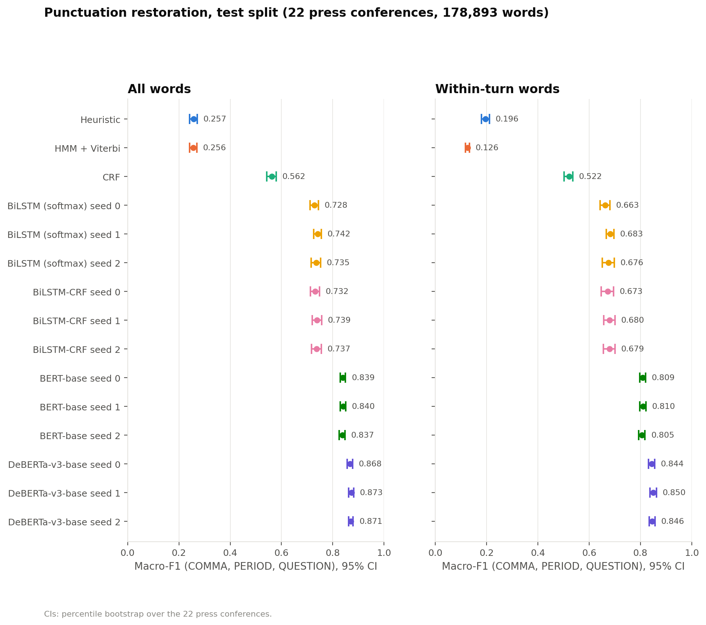
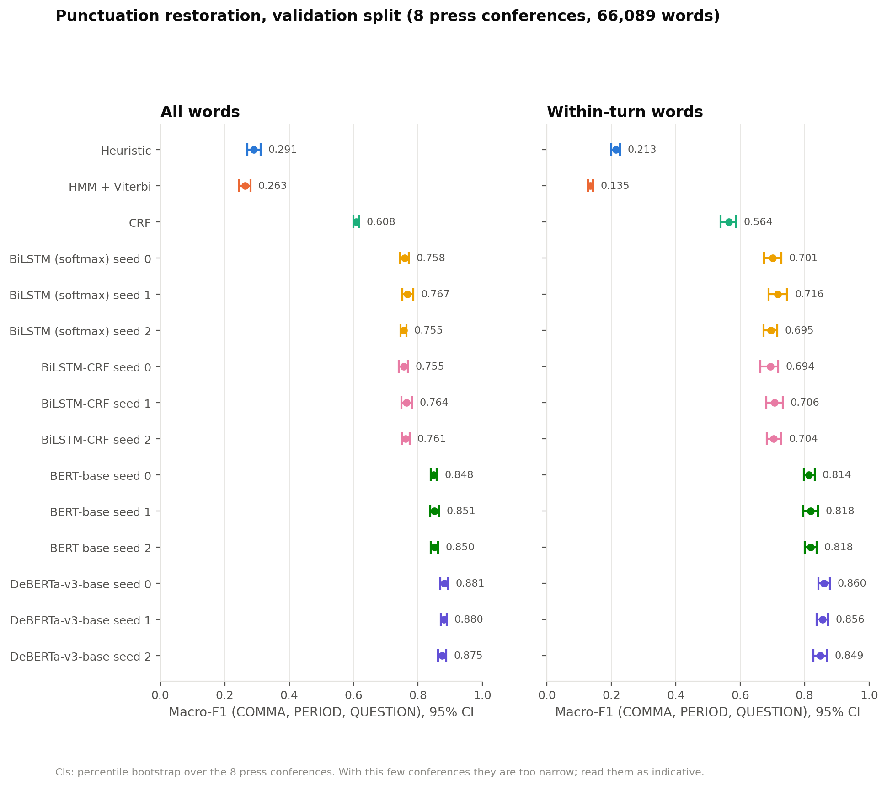
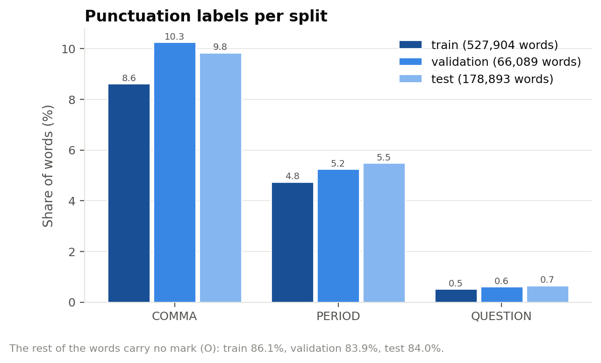
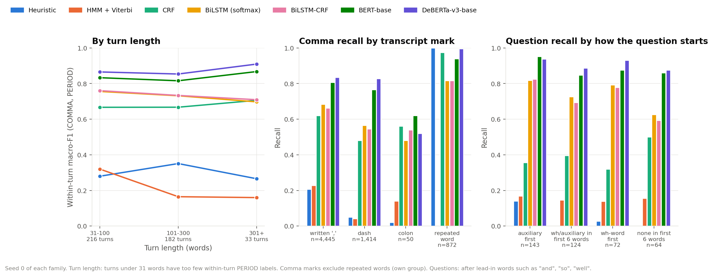
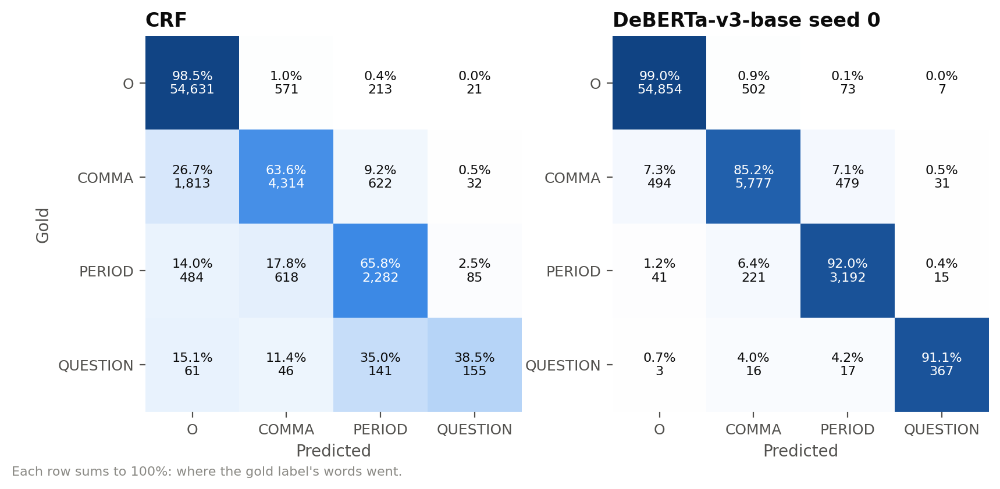

# Punctuation Restoration for FOMC Press Conference Transcripts

Token classification on a dataset we built and cleaned ourselves: given the
lower-cased, unpunctuated words of one speaker turn from a Federal Reserve
press conference, predict the punctuation mark that follows each word.

COE025 Natural Language Processing, Project 2 (token classification).

> **Status (24 October 2026).** All seven methods are trained, chosen on the
> validation split and scored **once** on the test split, after every model
> choice was fixed. Remaining: the members' own entries in
> [`contributions/`](contributions/) and the presentation (2 November 2026).

## Example

| | |
|---|---|
| Input | `we have covered a lot of ground and the full effects of our rapid tightening so far are yet to be felt even so we have more work to do` |
| Labels | `ground`→COMMA, `felt`→PERIOD, `so`→COMMA, `do`→PERIOD, every other word→O |
| Output text | we have covered a lot of ground, and the full effects of our rapid tightening so far are yet to be felt. even so, we have more work to do. |

(Chair Powell, opening statement, 1 February 2023; validation split.)

## Results on the test split

The test split (22 press conferences, 2024 – September 2026, 178,893 words)
was scored once, on 23 October 2026, with every model fixed beforehand on
validation. Macro-F1 over COMMA, PERIOD and QUESTION. "Within-turn" leaves out
the last word of every turn: the turn boundary is part of the input and that
word almost always ends a sentence, so within-turn scores show how well a
model finds sentence ends it is not given. 95% confidence intervals come from
a bootstrap over press conferences (1,000 resamples).

| Model | Macro-F1 [95% CI] | Within-turn macro-F1 [95% CI] | QUESTION F1 within turns |
|---|---|---|---|
| Heuristic rules | 0.257 [0.242, 0.272] | 0.196 [0.180, 0.212] | 0.003 |
| HMM + Viterbi | 0.256 [0.241, 0.270] | 0.126 [0.117, 0.133] | 0.000 |
| Linear-chain CRF | 0.562 [0.543, 0.579] | 0.522 [0.502, 0.537] | 0.298 |
| BiLSTM without CRF (ablation, 3 seeds) | 0.735 ± 0.007 | 0.674 ± 0.010 | 0.605–0.634 |
| BiLSTM-CRF (3 seeds) | 0.736 ± 0.004 | 0.678 ± 0.004 | 0.632–0.639 |
| BERT-base, `bert-base-uncased` (3 seeds) | 0.839 ± 0.001 | 0.808 ± 0.002 | 0.795–0.801 |
| **DeBERTa-v3-base, `microsoft/deberta-v3-base` (3 seeds)** | **0.870 ± 0.003** | **0.847 ± 0.003** | **0.821–0.837** |

For models trained with three seeds the table gives mean ± standard deviation
over seeds; each seed's own CI is in
[`results/test_summary.md`](results/test_summary.md) (ignore its latency
column: that pass was timed on battery power) and in the figure below. Paired
bootstrap differences in macro-F1 over every pair of runs: BiLSTM-CRF − CRF
+0.170 to +0.177, BERT − BiLSTM-CRF +0.098 to +0.108, DeBERTa-v3 − BERT +0.028
to +0.035 (all CIs above zero); BiLSTM-CRF − BiLSTM without CRF −0.010 to
+0.010 (for matched seeds the CIs include zero). The order is the same as on
validation: CRF < BiLSTM < BERT < DeBERTa-v3, with heuristic vs HMM and the
two BiLSTM variants tied on both splits.

From validation to test the scores drop more for the CRF and the BiLSTMs than
for the pretrained models: CRF 0.046, BiLSTM-CRF 0.024, BiLSTM without CRF
0.025, BERT 0.011, DeBERTa-v3 0.008 (heuristic 0.034; the HMM, near the
floor, 0.006; differences of unrounded means). We have not separated the
causes: tuning on validation inflates the validation scores, and the test
years are newer and include an unseen Chair (see Error analysis). The test
CIs rest on 22 press conferences instead of 8, but they are still percentile
intervals over a modest number of clusters, and the coverage check made for
validation was not repeated.



## Model selection (validation split)

Every choice (hyperparameters, learning rates, best epochs) was made on this
split; the numbers below are the selection results, so tuned models look
slightly better here than on test.

| Model | Macro-F1 [95% CI] | Within-turn macro-F1 [95% CI] | QUESTION F1 within turns | ms / 1,000 words |
|---|---|---|---|---|
| Heuristic rules | 0.291 [0.270, 0.311] | 0.213 [0.200, 0.227] | 0.010 | 0.14 (CPU) |
| HMM + Viterbi | 0.263 [0.245, 0.280] | 0.135 [0.127, 0.143] | 0.000 | 2.8 (CPU) |
| Linear-chain CRF | 0.608 [0.599, 0.616] | 0.564 [0.539, 0.588] | 0.337 | 4.1 (CPU) |
| BiLSTM without CRF (ablation, 3 seeds) | 0.760 ± 0.006 | 0.704 ± 0.011 | 0.625–0.663 | 54–56 (CPU) |
| BiLSTM-CRF (3 seeds) | 0.760 ± 0.004 | 0.701 ± 0.007 | 0.617–0.650 | 57–59 (CPU) |
| BERT-base, `bert-base-uncased` (3 seeds) | 0.850 ± 0.002 | 0.817 ± 0.003 | 0.776–0.793 | 26 (GPU) |
| **DeBERTa-v3-base, `microsoft/deberta-v3-base` (3 seeds)** | **0.879 ± 0.003** | **0.855 ± 0.006** | **0.818–0.842** | 30–31 (GPU) |

For models trained with three seeds the table gives mean ± standard deviation
over seeds; each seed's own CI is in
[`results/validation_summary.md`](results/validation_summary.md) and in the
figure below. Paired bootstrap differences in macro-F1, over every pair of
runs (all CIs above zero): BiLSTM-CRF − CRF +0.147 to +0.156 (3 pairs),
BERT − BiLSTM-CRF +0.084 to +0.095 (9 pairs), DeBERTa-v3 − BERT +0.025 to
+0.034 (9 pairs). Removing the CRF layer from the BiLSTM-CRF changes nothing
measurable on validation (see Error analysis).

Read these numbers with four cautions. Validation is the model-selection
set, so tuned models look slightly better here than they will on test. With
only 8 validation press conferences the bootstrap intervals are too narrow
(our check estimated about 85% real coverage instead of 95%), so they are
indicative. CPU latency is wall-clock time in one process with one thread;
this machine mixes performance and efficiency cores and repeated runs differ
by up to 4x, so compare orders of magnitude only (both BiLSTM variants were
timed in the same pass; the CRF's Viterbi decoding adds about 3 ms, within the
noise). GPU latency is the median of 3 timed passes after a warm-up, fp16,
batches of 64 windows, tokenization included, measured at the end of each
training run on an NVIDIA A100; it is not comparable with the CPU numbers.
Finally, BERT may still be under-tuned: its best learning rate is the largest
one we tried even after extending the grid, and all its runs peaked at the
last of their 4 epochs. For DeBERTa-v3 the chosen rate (5e-5) beat 3e-5 by
only 0.002 on seed 0, which is within seed-to-seed variation, and its runs
peaked at epochs 2–4.



## Task

Punctuation restoration as token classification, the kind of post-processing
that speech-recognition output needs. Input: the words of one speaker turn,
lower-cased, with all punctuation removed (the turn boundary is given). Output:
one label per word for the mark that follows it.

| Label | Marks in the transcript |
|---|---|
| O | none (ellipses also get O) |
| COMMA | `,` `:` and dashes used as pauses (em dash, spaced en dash) |
| PERIOD | `.` `!` `;` |
| QUESTION | `?` (wins over any other mark on the same word) |

The raw marks are stored next to the labels, so other mappings can be tried.
Casing restoration is out of scope.

## Data card

**Source.** Transcripts of the FOMC Chair's press conferences published by the
Board of Governors of the Federal Reserve System, April 2011 to September 2026:
95 PDFs, downloaded on 22 October 2026 from
`https://www.federalreserve.gov/mediacenter/files/FOMCpresconfYYYYMMDD.pdf`
(found through the Board's FOMC calendar pages). `data/raw/manifest.csv` lists
each URL, file size, SHA-256 and retrieval time.

**License.** The Board's [disclaimer page](https://www.federalreserve.gov/disclaimer.htm)
says that information on its website is in the public domain and may be copied
and distributed without permission, except material identified as coming from
a non-Board source, and asks users to cite the Board as the source. See
[`DATA_LICENSE.md`](DATA_LICENSE.md). Our code is MIT-licensed ([`LICENSE`](LICENSE)).

**Speakers.** Three Chairs in the training years (Bernanke, Yellen, Powell),
Powell in validation, Powell and Warsh in test (Warsh, June–September 2026, is
never seen in training). Reporters and the moderator speak in every
conference. Everyone in the data spoke on the public record; reporters
introduce themselves by name and outlet, and we keep the text as published.

**Cleaning** (`fomcpunct/clean.py`, counted per transcript in
`data/clean/cleaning_log.csv`). Text is extracted with pdfplumber; we remove
2,385 page headers and 2,385 "Page X of N" footers, 17 correction footnotes
with their markers, 88 stage notes and time stamps ("[Laughter]") and 190 title
lines; unwrap 311 editorial insertions ("[percent]"); split speaker turns at
speaker labels (including labels with a colon or no mark, Mc/accented names and
a second moderator); repair line-break hyphenation; and normalize quotes,
dashes, en-dash compounds, ellipses and fractions. Abbreviation periods (U.S.,
a.m.) stay inside the word (854 cases; 5 marked as sentence ends). Building
twice gives byte-identical files.

**Splits** (by press conference date, so no conference is in two splits):

| Split | Years | Conferences | Turns | Words | O | COMMA | PERIOD | QUESTION |
|---|---|---|---|---|---|---|---|---|
| train | 2011–2022 | 65 | 3,514 | 527,904 | 86.1% | 8.6% | 4.7% | 0.53% |
| validation | 2023 | 8 | 650 | 66,089 | 83.9% | 10.3% | 5.2% | 0.61% |
| test | 2024–2026 | 22 | 1,823 | 178,893 | 84.0% | 9.9% | 5.5% | 0.66% |

Out-of-vocabulary rate against train: 0.75% (validation), 1.15% (test).



**Known issues.** 13,683 COMMA labels come from dashes (some mark spoken
repairs, "at—at a modest rate"), and their share grows over the years. A few
labels are known to be noisy and were left as they are: 2 pauses typed as
unspaced en dashes (joined into one word), 6 sentence-final abbreviations not
marked as PERIOD, one suspended hyphen joined across a line break and 3 number
compounds split at a line-end hyphen.

**Files.** `data/raw/` (PDFs and manifest), `data/clean/turns.jsonl` (cleaned
turns with punctuation and speaker metadata), `data/processed/{train,validation,test}.jsonl`
(one turn per line: `id`, `doc`, `chair`, `role`, `words`, `labels`, `marks`)
and `data/processed/stats.json`.

## Methods

Baselines (methods from the course slides):

1. **Heuristic rules** (`heuristic.py`): turn end → PERIOD, repeated word →
   COMMA, PERIOD before "so"/"thank", COMMA after "you know", "of course",
   "i mean", "again", "hi" and before "which"/"but", question openers →
   QUESTION. Every rule and word list comes from training statistics (listed
   in the module).
2. **HMM with Viterbi decoding**, written from scratch (`hmm.py`): labels are
   states and words are emissions, add-k smoothing, `<unk>`/`<num>` emissions
   estimated from rare training words. Tuned: k ∈ {0.001, 0.01, 0.1, 1},
   min_count ∈ {1, 2, 3}.
3. **Linear-chain CRF** (`crf.py`, python-crfsuite, L-BFGS with L1/L2
   penalties): the word, its suffix and shape, words at −2…+3, three bigrams,
   repeat flags, first/last word of the turn. Tuned: c1 × c2 (25 settings);
   every setting converged.
4. **BiLSTM-CRF**, written from scratch in PyTorch (`bilstm_crf.py`;
   Lample et al., 2016, without character features): 100-d word embeddings
   trained from scratch → 2-layer bidirectional LSTM (256 units per direction)
   → linear layer → CRF layer with our own forward algorithm and Viterbi
   decoder (2.9 M parameters). Adam (lr 2e-3), batches of 16 turns of similar
   length, word dropout 0.05, early stopping on validation macro-F1 (patience
   5, at most 60 epochs). Tuned: hidden {128, 256} × layers {1, 2} × dropout
   {0.3, 0.5}; then seeds 0, 1, 2 of the best setting. Unit tests check the CRF
   against brute force over all label paths and with a gradient check.
5. **Ablation: BiLSTM without the CRF layer** (`bilstm_softmax.py`): the same
   network, setting and training, but each word's label is chosen on its own
   (softmax, word-level cross-entropy, argmax). The CRF's transition, start and
   end scores are gone, so label sequences are no longer modelled explicitly
   (the LSTM can still pick up some of that from context). It reuses the
   setting tuned for the BiLSTM-CRF without tuning of its own, so it measures
   what removing the CRF costs *this* model; on validation, where that setting
   was chosen, the gap leans in the CRF's favour, so the test split is the
   main evidence. Same seed means the same initial shared weights and batch
   order, but different dropout masks, so differences of about one seed
   standard deviation should not be read as real.

Pretrained transformers (architecture, then the exact checkpoint), fine-tuned
for token classification on Google Colab (`transformer.py`,
`notebooks/transformers_colab.ipynb`; the runs used an NVIDIA A100 GPU,
PyTorch 2.11 and transformers 5.20.2, recorded in each run card):

6. **BERT-base**, checkpoint `bert-base-uncased` (pinned revision), lr
   {2e-5, 3e-5, 5e-5, 8e-5}; chosen 8e-5.
7. **DeBERTa-v3-base**, checkpoint `microsoft/deberta-v3-base` (pinned
   revision), lr {1e-5, 2e-5, 3e-5, 5e-5}; chosen 5e-5. The new method beyond
   the slides.

The first search used three rates per model (without 8e-5 and 5e-5) and
picked the largest for both, so one larger rate was added to each grid and
the selection was redone on validation (seed-0 results for every rate in
`results/tuning/`). Gain from the extension: BERT 0.843 → 0.850, DeBERTa-v3
0.877 → 0.879 macro-F1 (seed means).

Both use the label on the first subword of each word, windows of at most 256
subwords that overlap by up to 64 words (at most half a window; each word is scored in the one window where
it has most context), AdamW with linear warm-up and decay, fp16 mixed
precision, 4 epochs, the best epoch by validation macro-F1, and seeds 0, 1, 2
of the learning rate chosen with seed 0.

## Evaluation

- **Main metric: macro-F1 over COMMA, PERIOD and QUESTION.** About 85% of words
  carry no mark, so accuracy would reward predicting no punctuation at all, and
  micro-F1 would be dominated by COMMA. Macro-F1 gives the rare QUESTION class
  the same weight as the others.
- **Second headline metric: within-turn macro-F1** (see Results).
- Also reported: per-class precision, recall and F1, micro-F1, mark-detection
  F1, accuracy and the 4×4 confusion matrix (`results/validation_metrics.json`).
- **95% CIs**: percentile bootstrap over press conferences, because words from
  one conference share a speaker and topic and are not independent. Paired
  bootstrap for differences between models.
- **Seeds**: neural models are trained with 3 seeds; we report mean and spread
  next to each seed's CI.
- **Latency**: wall-clock ms per 1,000 words in one CPU process with one thread,
  median of 5 runs after a warm-up, timed in a separate pass. GPU times of the
  transformers are marked and not comparable.
- **Selection** uses validation only; the test split is scored once at the end.

## Error analysis

The analysis was written on validation while models were being chosen; the
same reports were produced once for test after the test scoring. Four reports
with full tables and examples, each for both splits:
`results/error_analysis/{validation,test}_transformers.md` (CRF, BiLSTM-CRF,
BERT and DeBERTa-v3, all seeds; examples from DeBERTa-v3 seed 0, compared
with BiLSTM-CRF seed 0) and `results/error_analysis/{validation,test}.md`
(CRF and both BiLSTM variants; examples from BiLSTM-CRF seed 0, compared with
the CRF): [validation transformers](results/error_analysis/validation_transformers.md),
[test transformers](results/error_analysis/test_transformers.md),
[validation BiLSTM](results/error_analysis/validation.md),
[test BiLSTM](results/error_analysis/test.md). Ranges are over the three seeds
of a model.

### On the test split

- **What held**: the order of the models; no measurable effect of the CRF
  layer; DeBERTa-v3 making about half the errors of the BiLSTM-CRF
  (5,395–5,516 wrong words against 11,756–12,107); the CRF's advantage on
  repeated words (97% against 80% for the BiLSTM-CRF; DeBERTa-v3 99%); dash
  commas found about as often as written ones by DeBERTa-v3 (82–85% vs
  81–84%); the transformers doing best on the prepared opening statements
  (DeBERTa-v3 0.905–0.915 against 0.845–0.850 on spontaneous speech); and
  questions inside turns staying harder than at turn ends (DeBERTa-v3 83–86%
  against 95–96%; BiLSTM-CRF 57–62% against 92–95%; CRF 22% against 42%).
- **What did not hold**: on validation the CRF beat the BiLSTM-CRF on the
  prepared opening statements; on test the result is mixed (CRF 0.591,
  BiLSTM-CRF 0.556–0.634 within-turn macro-F1 over COMMA and PERIOD). Extra
  commas were DeBERTa-v3's most common error for every seed on validation,
  but on test only for seed 2; its three main error types (COMMA→PERIOD,
  missed commas, extra commas) are of similar size there.
- **The unseen Chair**: Chair Warsh appears only in test (3 conferences, 67
  turns, 14,278 words). Every model scores lower on his speech than on
  Powell's in the same split (within-turn macro-F1 over COMMA and PERIOD):
  DeBERTa-v3 0.802–0.807 against 0.861–0.863, BERT 0.731–0.740 against
  0.817–0.824, BiLSTM-CRF 0.550–0.565 against 0.703–0.711, CRF 0.471 against
  0.652. Of these four, the pretrained models drop the least, both in
  absolute and relative terms (about 0.06 or 7% for DeBERTa-v3, 0.085 or 10%
  for BERT, 0.15 or 21% for the BiLSTM-CRF, 0.18 or 28% for the CRF). Three
  conferences are a small sample, and a new Chair also brings new topics and
  a newer period, so this is not a pure speaker effect.

### On the validation split (written during model selection)



#### Pretrained transformers

- **DeBERTa-v3 makes about half the errors of the BiLSTM-CRF** (1,899–1,961
  wrong words against 3,929–4,021; BERT 2,407–2,462). On gold commas,
  DeBERTa-v3 seed 0 fixes 1,564 of BiLSTM-CRF seed 0's 2,326 errors and makes
  242 new ones.
- **Its most common error is now a comma where the transcript has none**
  (O→COMMA, 26–30% of its errors), ahead of missed commas (22–26%) and
  COMMA→PERIOD (21–25%); for seed 0 the three are close (502, 494, 479).
  Whether these extra commas are wrong or just optional is not measured.
- **DeBERTa-v3 no longer shows the BiLSTM-CRF's specific weaknesses.** On the
  Chair's prepared opening statements it reaches within-turn macro-F1
  0.950–0.963 over COMMA and PERIOD (BERT 0.911–0.929; BiLSTM-CRF
  0.641–0.706; CRF 0.742), higher than on spontaneous Chair answers and
  reporter turns (0.851–0.859); with 8 statements this is a lead to check on
  test. One possible reason, not tested: the transformers were pretrained on
  written text. Repeated words get their comma 99% of the time (BERT 94%;
  BiLSTM-CRF 82–84%), and commas written as dashes are found about as often
  as written commas (83–84% vs 84–86%). BERT still finds dash commas less
  often (77–78% vs 81–82%).
- **Questions inside turns**: recall 84–88% for DeBERTa-v3 and 81–82% for
  BERT, against 56–63% for the BiLSTM-CRF; at turn ends all three are at
  92–97%, so finding questions without the turn boundary is still the harder
  part.
- **Commas before conjunctions are still often missed**: before "and" (where
  the transcript has a comma 34% of the time) DeBERTa-v3 finds 72–74% of the
  gold commas (BiLSTM-CRF 55–56%), and before "but" 66–70%, about the same
  as the CRF (67%). How many of these commas are optional is not measured.

#### BiLSTM-CRF and the classical models

- **The CRF layer adds nothing measurable here.** Without it the same BiLSTM
  scores 0.760 ± 0.006 macro-F1 (with it: 0.760 ± 0.004), and the
  matched-seed differences are −0.003, −0.003 and +0.006, so the sign depends
  on the seed, even though the setting was tuned with the CRF. A likely reason:
  unlike BIO tags in NER, these four labels have no forbidden transitions, and
  the BiLSTM already reads the whole turn in both directions. The CRF does
  produce fewer back-to-back sentence ends (17–26 predicted, against 29–36
  without it and 27 in the gold data), but that barely moves the scores. The
  weaknesses below (repeated words, prepared statements) appear with and
  without the CRF, so they come from the BiLSTM encoder.

- **Missed commas are the largest error group for every model except
  DeBERTa-v3** (COMMA→O is 38–41% of the BiLSTM-CRF's errors). Part of this is optionality: the
  transcript writes a comma before "and" only 34% of the time, and the models
  find 53% (CRF) to 55–56% (BiLSTM-CRF) of those.
- **Next come COMMA→PERIOD, O→COMMA and PERIOD→COMMA** (686, 641 and 383 for
  BiLSTM-CRF seed 0): where a clause ends, the choice between a comma and a
  full stop is hard. In the sampled examples several of these read well
  either way (for example "inflation to 2 percent over time, the committee
  will take into account ..." predicted with a full stop); we have not
  measured how often.
- **The BiLSTM-CRF's gain over the CRF is mostly at sentence level**: per-class
  F1 rises by +0.02 to +0.04 for COMMA, +0.08 to +0.09 for PERIOD and +0.33
  to +0.35 for QUESTION (within turns, QUESTION F1 0.34 → 0.62–0.65). Of the
  166 gold questions that seed 0 gets right and the CRF misses, 90 are the
  last word of a turn, where the turn boundary helps.
- **Commas written as dashes are harder than written commas**: recall 48% vs
  62% for the CRF and 55–56% vs 66–69% for the BiLSTM-CRF (commas before a
  repeated word left out of both).
- **Repeated words** ("the, the"; 872 gold commas, almost all written ",")
  get a comma from the CRF 97% of the time but from the BiLSTM-CRF only
  82–84%. The CRF has an explicit "next word is the same" feature; the
  BiLSTM has to learn it from embeddings.
- **Questions inside turns stay hard**: BiLSTM-CRF question recall is 92–95%
  at turn ends but 56–63% inside turns (CRF: 50% and 27%). After skipping
  lead-in words such as "and", "so" and "well", questions that open with an
  auxiliary verb are found 83–87% of the time, and those with no wh-word or
  auxiliary in their first six words 59–70%.
- **Prepared vs spontaneous speech**: on the Chair's opening statements (read
  from a script; 8 turns, 9,270 words, no questions) the CRF does better than
  the BiLSTM-CRF (within-turn macro-F1 over COMMA and PERIOD 0.742 vs
  0.641–0.706), mainly because the BiLSTM-CRF finds fewer of the commas there
  (recall 0.42–0.56 vs 0.60). On spontaneous speech it is the other way round
  (Chair answers 0.672 vs 0.732–0.736; reporter turns 0.633 vs 0.746–0.749).
  Turn length does not explain it: on the 25 Chair answers longer than 300
  words the BiLSTM-CRF also leads (0.736–0.745 vs 0.673). With 8 statements
  this is a lead to check on test, not a finding.



## Reproduce

Tested with Python 3.13 on Windows. Everything except the transformers runs on a CPU.

```bash
python -m venv .venv
.venv/Scripts/activate            # Windows; on Linux/macOS: source .venv/bin/activate
pip install -r requirements.txt
python -m unittest                # unit tests
```

Data (the raw PDFs and the built files are already in the repository; these
commands rebuild them):

```bash
python -m fomcpunct.download      # 95 transcript PDFs -> data/raw/
python -m fomcpunct.build         # data/clean/ and data/processed/
```

Models on validation (selection uses validation only):

```bash
python -m fomcpunct.run_baselines --models heuristic hmm crf --tune --jobs 6
python -m fomcpunct.run_baselines --models heuristic hmm crf      # quiet latency pass
python -m fomcpunct.train_bilstm --tune --jobs 8 --threads 2
python -m fomcpunct.train_bilstm --seeds 0 1 2 --jobs 3 --threads 2
python -m fomcpunct.train_bilstm_softmax --seeds 0 1 2 --jobs 3 --threads 2
```

Transformers on Google Colab: `python -m fomcpunct.colab bundle` writes a zip
with the code and data; upload it to Google Drive, run
`notebooks/transformers_colab.ipynb` on a GPU, then bring the results back with
`python -m fomcpunct.colab import p2_transformer_results.zip` (it checks that the
runs used the same data and transformer code).

Scores, error analysis and figures:

```bash
python -m fomcpunct.evaluate --split validation --models heuristic hmm crf bilstm_softmax_s0 bilstm_softmax_s1 bilstm_softmax_s2 bilstm_crf_s0 bilstm_crf_s1 bilstm_crf_s2 bert_s0 bert_s1 bert_s2 deberta_s0 deberta_s1 deberta_s2
python -m fomcpunct.error_analysis --models crf bilstm_softmax_s0 bilstm_softmax_s1 bilstm_softmax_s2 bilstm_crf_s0 bilstm_crf_s1 bilstm_crf_s2 --focus bilstm_crf_s0 --reference crf
python -m fomcpunct.error_analysis --models crf bilstm_crf_s0 bilstm_crf_s1 bilstm_crf_s2 bert_s0 bert_s1 bert_s2 deberta_s0 deberta_s1 deberta_s2 --focus deberta_s0 --reference bilstm_crf_s0 --tag transformers
python -m fomcpunct.figures --focus deberta_s0 --reference crf
```

Test split (done once, on 23 October 2026, after all choices were fixed). The
BiLSTM scripts refuse to retrain for it; `run_baselines` refits the heuristic
and the HMM from train with their fixed settings (deterministic) and would
refit the CRF the same way if its saved model did not match (it matched). The
transformer runs keep no weights: their test predictions were written during
training, at the kept epoch (`results/predictions/{bert,deberta}_s*.test.jsonl`).

```bash
python -m fomcpunct.run_baselines --models heuristic hmm crf --split test
python -m fomcpunct.train_bilstm --seeds 0 1 2 --split test
python -m fomcpunct.train_bilstm_softmax --seeds 0 1 2 --split test
python -m fomcpunct.evaluate --split test --models heuristic hmm crf bilstm_softmax_s0 bilstm_softmax_s1 bilstm_softmax_s2 bilstm_crf_s0 bilstm_crf_s1 bilstm_crf_s2 bert_s0 bert_s1 bert_s2 deberta_s0 deberta_s1 deberta_s2
python -m fomcpunct.error_analysis --split test --models crf bilstm_softmax_s0 bilstm_softmax_s1 bilstm_softmax_s2 bilstm_crf_s0 bilstm_crf_s1 bilstm_crf_s2 --focus bilstm_crf_s0 --reference crf
python -m fomcpunct.error_analysis --split test --models crf bilstm_crf_s0 bilstm_crf_s1 bilstm_crf_s2 bert_s0 bert_s1 bert_s2 deberta_s0 deberta_s1 deberta_s2 --focus deberta_s0 --reference bilstm_crf_s0 --tag transformers
python -m fomcpunct.figures --split test --focus deberta_s0 --reference crf
```

Latency is reported from the validation timing passes only. The test pass was
timed while the laptop ran on battery power, so the latency column of
`results/test_summary.md` is not used, and `figures` draws no speed chart for
test.

Trained local models are written to `models/` (not tracked: about 40 MB).
Each one has a card with a fingerprint of its settings, data and code, and is
reused only if the fingerprint still matches. The transformer run cards
(`results/training/{bert,deberta}_s*.json`) record the GPU and library
versions of the exported runs; the seed-0 learning-rate trials are kept in
`results/tuning/`.

## Repository layout

```text
fomcpunct/                 package
  download.py, clean.py, tokens.py, build.py      data pipeline
  heuristic.py, hmm.py, crf.py, run_baselines.py  classical baselines
  bilstm_crf.py, train_bilstm.py                  BiLSTM-CRF
  bilstm_softmax.py, train_bilstm_softmax.py      no-CRF ablation
  transformer.py, colab.py                        BERT / DeBERTa on Colab
  metrics.py, evaluate.py                         scores, bootstrap CIs
  error_analysis.py, figures.py                   analysis and plots
tests/                     unit tests (python -m unittest)
notebooks/                 Colab notebook for the transformer runs
data/raw/                  PDFs and manifest
data/clean/                cleaned speaker turns and cleaning log
data/processed/            train / validation / test (JSONL) and stats
results/                   tuning, params, predictions, latency, training curves,
                           metrics, summaries, error analysis, figures
contributions/             one file per team member
```

## License and citation

Code: MIT ([`LICENSE`](LICENSE)). Data: transcripts from the Board of Governors
of the Federal Reserve System, public domain per the Board's website; see
[`DATA_LICENSE.md`](DATA_LICENSE.md). Source: Board of Governors of the Federal
Reserve System, *FOMC Press Conference Transcripts*, 2011–2026,
https://www.federalreserve.gov/monetarypolicy/fomccalendars.htm.

## Team

| Member | Student ID | GitHub |
| --- | --- | --- |
| Berkay Hakan Sadi | 2309011065 | [hakanstarlord](https://github.com/hakanstarlord) |
| Fatih Safran Dündar | 2309011133 | [fatihsafran](https://github.com/fatihsafran) |
| Aamer mashar sanjer | 2309015705 | [aamersanjer0-a11y](https://github.com/aamersanjer0-a11y) |
| Kaan Kalkan | 220901594 | [kaankalkan03](https://github.com/kaankalkan03) |
| hilal ibrahimoglu | 229920269 | [hilalibrahimoglu](https://github.com/hilalibrahimoglu) |
| MOOAZ SADIK | 2309015405 | [moathkhaled2k5](https://github.com/moathkhaled2k5) |

Individual contribution records and the project's AI-assistance statement are
in [`contributions/`](contributions/). The code, analysis and documentation
were produced with substantial help from an AI assistant (Claude).
